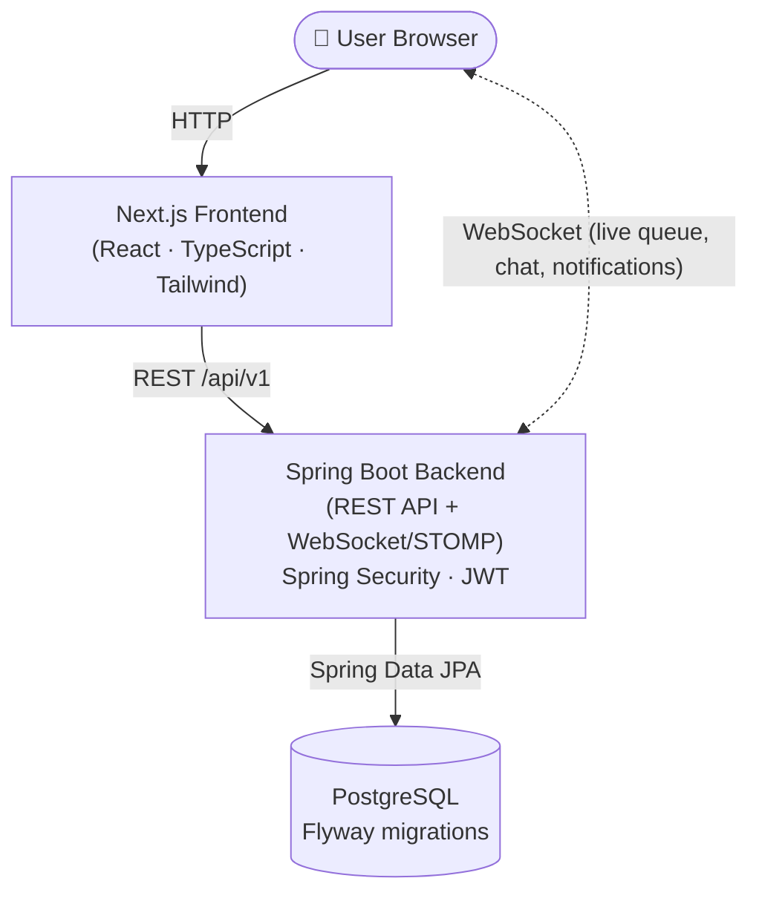
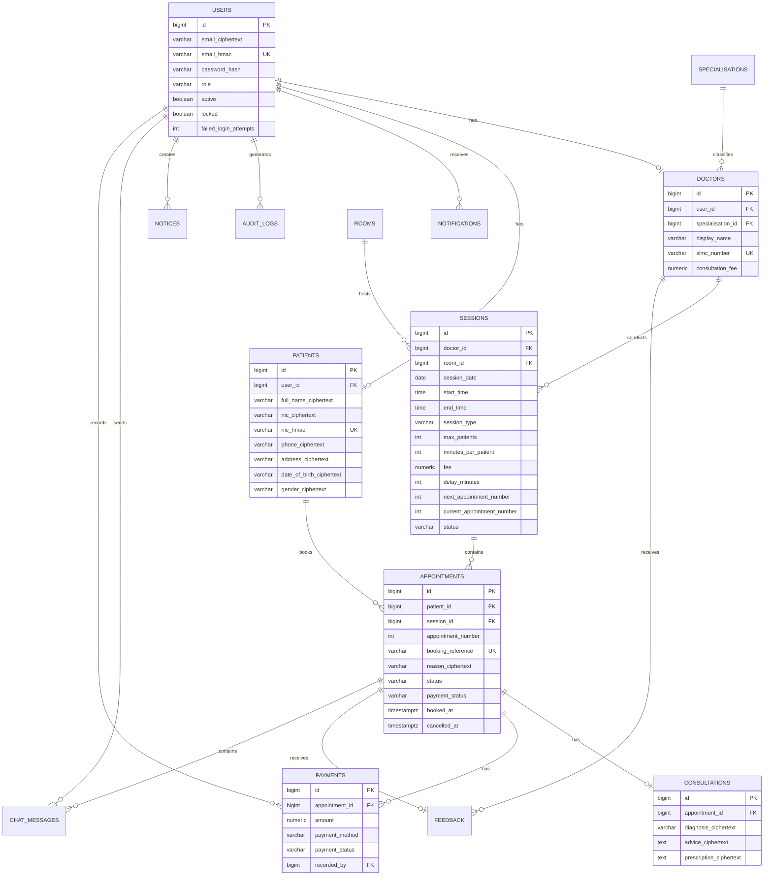

<div align="center">

# 🏥 MediChannel

### Hospital Channelling & Appointment Management System

_A secure, real-time, full-stack platform for booking doctors, following live queues, and consulting online._


**🌐 Live Website: [http://18.140.113.216/](http://18.140.113.216/)**

</div>

---

## 📑 Table of Contents

1. [Project Overview](#1-project-overview)
2. [Key Features](#2-key-features)
3. [User Roles & Permissions](#3-user-roles--permissions)
4. [System Architecture](#4-system-architecture)
5. [Technology Stack](#5-technology-stack)
6. [Project Structure](#6-project-structure)
7. [Database Design](#7-database-design)
8. [Business Rules](#8-business-rules)
9. [Real-Time Features](#9-real-time-features-websockets)
10. [Security & Encryption](#10-security--encryption)
11. [Getting Started](#11-getting-started)
12. [Environment Variables](#12-environment-variables)
13. [API Reference](#13-api-reference)
14. [Deployment & Infrastructure](#14-deployment--infrastructure)
15. [Git Workflow](#15-git-workflow)
16. [Development Standards](#16-development-standards)
17. [Troubleshooting](#17-troubleshooting)
18. [Roadmap](#18-roadmap)
19. [Team](#19-team)

---

## 1. Project Overview

**MediChannel** digitizes the channelling and appointment workflow of **Lanka Care Hospital** (Colombo), which has 40 visiting doctors across 15 specialisations and runs 120+ sessions per week.

### The Problem

Appointments are currently taken by phone and recorded in a paper register. This leads to:

- Repeated phone calls and **duplicate appointment numbers**
- Patients waiting hours without knowing which number is being served
- Online consultations on doctors' personal messaging apps
- Mass phone calls whenever a session is cancelled
- Patient data stored in unprotected spreadsheets

### The Solution

MediChannel lets patients book a doctor for a **physical examination** or an **online consultation**, follow the queue **live**, and chat with the doctor in a **secure real-time room**, while the hospital team manages doctors, sessions, payments, and reports.

### Objectives

| Objective      | Description                                                                  |
| -------------- | ---------------------------------------------------------------------------- |
| **Secure**     | All personal and medical data encrypted in transit and at rest               |
| **Reliable**   | An appointment number is never issued twice                                  |
| **Live**       | Queue, availability, chat, and notifications update instantly via WebSockets |
| **Accessible** | Responsive interface, hosted online                                          |

> **Current status:** The repository contains a working full-stack foundation: backend health-check APIs, database connectivity checks, Flyway migrations, a CRUD demonstration, and deployment on AWS. The complete healthcare modules are under active development (see the [Roadmap](#18-roadmap)).

---

## 2. Key Features

### 👤 Public & Patient

- **Search** doctors by name, specialisation, date, and session type (`PHYSICAL` / `ONLINE`), with live "numbers left"
- **Register / log in** with full validation; 5 failed logins lock the account for 15 minutes
- **Book** physical or online appointments and receive an appointment number, estimated time, room, and booking reference
- **My appointments** with status, payment status, live "now serving" number, and patients ahead
- **Cancel** unpaid appointments (until 3 hours before the session)
- **Online consultation** through a private real-time chat
- **After the visit:** read/print the consultation summary and prescription, and leave feedback (1–5 + comment)
- **Notifications** when 3 numbers away, when called, and when a session is delayed or cancelled

### 🩺 Doctor

- View own sessions and patient lists (number, name, type, check-in status)
- Start a session, call the next patient, mark `COMPLETED` / `NO_SHOW`, end the session
- Run online consultations: live chat, diagnosis summary, advice, and prescription

### 🗂️ Manager (Channelling Centre)

- Manage specialisations, rooms, doctor profiles, and sessions (create, edit, **delay**, **cancel**)
- Reception desk: mark patients `ARRIVED`, record payments, book walk-in patients
- Publish notices; approve, hide, or delete feedback
- Dashboard and reports: appointments per day, physical vs online, no-show rate, revenue, top doctors, average ratings

### 🛡️ Admin (IT Administrator)

- Create `DOCTOR` and `MANAGER` accounts; activate/deactivate accounts; reset staff passwords
- View the immutable **audit log** (logins, account changes, cancellations, consultation-record access)

---

## 3. User Roles & Permissions

Public registration always creates a `CUSTOMER`. `DOCTOR` and `MANAGER` accounts are created only by an `ADMIN`; the first `ADMIN` is created at start-up from environment variables. **Every permission is enforced on the server**, including WebSocket messages.

| Role         | Who              | Main Capabilities                                                                                       |
| ------------ | ---------------- | ------------------------------------------------------------------------------------------------------- |
| **Guest**    | Anyone           | Search doctors/sessions, view live availability, read notices, register, log in                         |
| **CUSTOMER** | Patient          | Book/cancel own appointments, follow live queue, join own consultation, read own summary, give feedback |
| **DOCTOR**   | Consultant       | Manage own sessions and queue, run consultations, write notes and prescriptions                         |
| **MANAGER**  | Centre Manager   | Manage doctors, rooms, sessions, reception, payments, notices, feedback, reports                        |
| **ADMIN**    | IT Administrator | Manage staff accounts, view audit log and system dashboard                                              |

> 🔒 **Privacy rule:** `ADMIN` and `MANAGER` can **never** read consultation notes, prescriptions, reasons for visit, or chat messages. Medical data is visible only to the patient and the treating doctor.

---

## 4. System Architecture

MediChannel follows a **three-tier architecture** with REST for request/response and STOMP over WebSocket for real-time events.



### Layer Responsibilities

| Layer        | Responsibilities                                                                                         |
| ------------ | -------------------------------------------------------------------------------------------------------- |
| **Frontend** | UI and navigation, role-based pages, route protection, form validation, API communication, live updates  |
| **Backend**  | REST endpoints, business rules, validation, authentication/authorization, encryption, WebSocket handling |
| **Database** | Persistent storage with constraints, indexes, and migration-controlled schema                            |

---

## 5. Technology Stack

| Area               | Technology               | Purpose                          |
| ------------------ | ------------------------ | -------------------------------- |
| **Frontend**       | Next.js 16 (App Router)  | Framework and routing            |
|                    | React 19                 | UI components                    |
|                    | TypeScript               | Type safety                      |
|                    | Tailwind CSS             | Styling                          |
| **Backend**        | Java 25                  | Language                         |
|                    | Spring Boot 4.1.2        | Application framework            |
|                    | Spring Web MVC           | REST API                         |
|                    | Spring Data JPA          | Persistence                      |
|                    | Spring Security          | Authentication and authorization |
|                    | Spring WebSocket (STOMP) | Real-time communication          |
|                    | Maven                    | Build and dependency management  |
| **Database**       | PostgreSQL 14+           | Relational database              |
|                    | Flyway                   | Schema version control           |
| **Infrastructure** | AWS EC2 (Ubuntu)         | Hosting                          |

---

## 6. Project Structure

```text
medichannel/
├── backend/                          # Spring Boot REST API
│   ├── src/
│   │   ├── main/
│   │   │   ├── java/                 # Application source code
│   │   │   └── resources/
│   │   │       ├── application.properties
│   │   │       └── db/migration/     # Flyway migrations (V1__*.sql, ...)
│   │   └── test/                     # Backend tests
│   ├── pom.xml
│   ├── mvnw                          # Maven wrapper (Linux/macOS)
│   └── mvnw.cmd                      # Maven wrapper (Windows)
│
├── frontend/                         # Next.js application
│   ├── app/                          # Pages and routes (App Router)
│   ├── lib/                          # API client helpers
│   ├── public/                       # Static assets
│   └── package.json
│
├── database/
│   └── schema.sql                    # Full PostgreSQL schema
│
├── docs/
│   ├── assignment/                   # Assignment brief
│   ├── diagrams/                     # ER diagram, architecture
│   └── architecture/                 # Network and infrastructure notes
│
├── .gitignore
└── README.md
```

---

## 7. Database Design

**Database name (development):** `medichannel_dev`
**Full schema:** [`database/schema.sql`](database/schema.sql) · **ER diagram:** [`docs/diagrams/ER.png`](docs/diagrams/ER.png)

### 7.1 Entity Overview

| Table             | Purpose                                            |
| ----------------- | -------------------------------------------------- |
| `users`           | Accounts, roles, lock status, failed-login counter |
| `patients`        | Encrypted patient profile data                     |
| `specialisations` | Medical specialisations                            |
| `doctors`         | Doctor profiles (SLMC number, qualifications, fee) |
| `rooms`           | Physical consultation rooms                        |
| `sessions`        | Doctor channelling sessions (physical or online)   |
| `appointments`    | Patient bookings within sessions                   |
| `consultations`   | Encrypted diagnosis, advice, prescription          |
| `payments`        | Payment records per appointment                    |
| `chat_messages`   | Encrypted doctor–patient chat                      |
| `notifications`   | Per-user in-app notifications                      |
| `feedback`        | Patient ratings and comments                       |
| `notices`         | Hospital announcements                             |
| `audit_logs`      | Immutable activity log                             |

### 7.2 Entity Relationship Diagram



> The diagram above is condensed. The complete diagram with every column is in [`docs/diagrams/ER.png`](docs/diagrams/ER.png).

### 7.3 Database Conventions

- **Constraints:** primary keys, foreign keys, `UNIQUE`, `NOT NULL`, and `CHECK` constraints on all key tables
- **Indexes:** at least two indexes on frequently queried columns
- **Money** uses `NUMERIC`; **timestamps** use `TIMESTAMPTZ`; the application time zone is `Asia/Colombo`
- **Records with history are never deleted**; their status changes instead
- **Seed data** is fictional only, covering every role and every appointment status

### 7.4 Migrations (Flyway)

Migrations live in `backend/src/main/resources/db/migration/`.

```text
V1__create_crud_test_records.sql
```

> ⚠️ **Never edit an already-applied migration** in a shared environment. Add a new versioned migration (`V2__...`, `V3__...`) for every schema change.

---

## 8. Business Rules

These rules are enforced in the Spring Boot service layer and, where suitable, by database constraints.

| ID        | Rule                                                                                                                                                                                                                                                    |
| --------- | ------------------------------------------------------------------------------------------------------------------------------------------------------------------------------------------------------------------------------------------------------- |
| **BR-01** | A session has one doctor, date, start/end time, type, max patients (1–60), minutes per patient (5–30), fee in LKR, and status (`SCHEDULED`, `OPEN`, `IN_PROGRESS`, `COMPLETED`, `CANCELLED`). Physical sessions require a room; online sessions do not. |
| **BR-02** | A doctor cannot have overlapping sessions; a room cannot host two sessions at the same time.                                                                                                                                                            |
| **BR-03** | Appointment numbers start at 1 per session, are unique, never reused, and never exceed max patients, even under concurrent bookings.                                                                                                                    |
| **BR-04** | A patient may have only one active appointment per session.                                                                                                                                                                                             |
| **BR-05** | Booking closes **1 hour** before a physical session and **30 minutes** before an online session.                                                                                                                                                        |
| **BR-06** | Estimated time = `start_time + (number − 1) × minutes_per_patient + session_delay`.                                                                                                                                                                     |
| **BR-07** | A patient may cancel an unpaid appointment until **3 hours** before the session. Cancelled appointments are kept, not deleted.                                                                                                                          |
| **BR-08** | Status flow: `BOOKED → ARRIVED` (physical) `→ IN_CONSULTATION → COMPLETED`; not seen = `NO_SHOW`. Online: `BOOKED → IN_CONSULTATION`.                                                                                                                   |
| **BR-09** | An online room opens only when the doctor starts that appointment, admits only that patient and doctor, and becomes read-only when it ends.                                                                                                             |
| **BR-10** | Valid Sri Lankan NIC (9 digits + `V`/`X`, or 12 digits); phone format `07XXXXXXXX`; unique email and NIC; passwords of 8+ characters with a letter, number, and symbol.                                                                                 |
| **BR-11** | Records with history are never deleted. Times use `Asia/Colombo`. Money uses `NUMERIC`.                                                                                                                                                                 |

---

## 9. Real-Time Features (WebSockets)

Implemented with Spring Boot WebSocket support (STOMP); `wss://` in production.

| ID        | Feature           | Description                                                                                        |
| --------- | ----------------- | -------------------------------------------------------------------------------------------------- |
| **RT-01** | Live queue        | "Now serving" number updates instantly for patients, doctor, and manager                           |
| **RT-02** | Live availability | "Numbers left" updates after every booking or cancellation                                         |
| **RT-03** | Consultation chat | Private doctor–patient chat with typing indicator and connection status; messages stored encrypted |
| **RT-04** | Notifications     | Called, 3 numbers away, delayed, cancelled, consultation started, sent only to the affected user   |

**WebSocket security:** the connection is authenticated with the login token, permissions are checked on every subscription and message, chat messages are limited to 1000 characters, and clients reconnect automatically after a network drop.

---

## 10. Security & Encryption

MediChannel handles healthcare data, so security is a core requirement.

| Area                            | Implementation                                                                                                                                                                                        |
| ------------------------------- | ----------------------------------------------------------------------------------------------------------------------------------------------------------------------------------------------------- |
| **In transit**                  | HTTPS for all parts; `wss://` for WebSockets                                                                                                                                                          |
| **Passwords**                   | bcrypt hashes only, never stored, logged, or returned in plain text                                                                                                                                   |
| **At rest**                     | AES-256-GCM with a random IV per value (e.g. JPA `AttributeConverter`) for email, full name, NIC, date of birth, phone, address, reason for visit, diagnosis, advice, prescription, and chat messages |
| **Searchable encrypted fields** | HMAC-SHA256 hashes of email and NIC stored in separate columns for login, uniqueness, and search                                                                                                      |
| **Tokens**                      | Signed JWT with expiry, stored in an HTTP-only, Secure cookie set by a Next.js route handler                                                                                                          |
| **Access control**              | Role and ownership checks on the server for every endpoint and WebSocket message                                                                                                                      |
| **Account protection**          | 5 failed logins lock the account for 15 minutes; a single generic login error message                                                                                                                 |
| **Audit**                       | Immutable audit log of logins, account changes, cancellations, and consultation-record access (never contains medical data)                                                                           |
| **Input handling**              | Request validation, JPA (no string-built SQL), safe output rendering, no personal data or stack traces in logs or errors                                                                              |
| **CORS**                        | Only the frontend URL is allowed                                                                                                                                                                      |

### Security Rules for Developers

- ❌ Never commit `.env` / `.env.local` files, passwords, API keys, JWT secrets, or encryption keys
- ❌ Never commit private SSH keys (`.pem`) or credentials
- ❌ Never log patient information
- ✅ Use fictional data only. Never use real NICs, phone numbers, or medical information
- ✅ Report vulnerabilities to the project team immediately

---

## 11. Getting Started

### 11.1 Prerequisites

| Software           | Version                 | Download                             |
| ------------------ | ----------------------- | ------------------------------------ |
| Git                | Latest stable           | https://git-scm.com/downloads        |
| Node.js (with npm) | 20+                     | https://nodejs.org/                  |
| Java JDK           | 25                      | https://adoptium.net/                |
| PostgreSQL         | 14+                     | https://www.postgresql.org/download/ |
| IDE                | VS Code / IntelliJ IDEA | https://code.visualstudio.com/       |

Verify the installation:

```bash
git --version
node --version
npm --version
java --version
psql --version
```

### 11.2 Clone the Repository

```bash
git clone https://github.com/USERNAME/medichannel.git
cd medichannel
git fetch origin
git checkout dev
git pull origin dev
```

> Replace `USERNAME` with the actual GitHub organization or repository owner.

### 11.3 Create the Database

```bash
createdb medichannel_dev
```

(or create it in pgAdmin). The backend runs with `spring.jpa.hibernate.ddl-auto=validate`, so tables must come from the Flyway migrations or another approved schema initialization process.

### 11.4 Configure Environment Variables

See [Environment Variables](#12-environment-variables).

### 11.5 Run the Backend

```bash
cd backend
```

| OS            | Command                      |
| ------------- | ---------------------------- |
| Windows       | `.\mvnw.cmd spring-boot:run` |
| Linux / macOS | `./mvnw spring-boot:run`     |

Backend URL: **http://localhost:8080**

### 11.6 Run the Frontend

In a second terminal:

```bash
cd frontend
npm install
npm run dev
```

Frontend URL: **http://localhost:3000**

### 11.7 Verify the Setup

| URL                                    | Description                    |
| -------------------------------------- | ------------------------------ |
| http://localhost:3000                  | Application health/status page |
| http://localhost:3000/crud-test        | CRUD demonstration page        |
| http://localhost:8080/api/v1/health    | Backend health check           |
| http://localhost:8080/api/v1/db-health | Database connectivity check    |

---

## 12. Environment Variables

### Backend

Configured in `backend/src/main/resources/application.properties`:

```properties
spring.datasource.url=${DB_URL:jdbc:postgresql://localhost:5432/medichannel_dev}
spring.datasource.username=${DB_USERNAME:postgres}
spring.datasource.password=${DB_PASSWORD}

spring.jpa.hibernate.ddl-auto=validate
server.port=8080
```

| Variable      | Description         | Required                      |
| ------------- | ------------------- | ----------------------------- |
| `DB_URL`      | PostgreSQL JDBC URL | Optional (has local default)  |
| `DB_USERNAME` | PostgreSQL username | Optional (default `postgres`) |
| `DB_PASSWORD` | PostgreSQL password | **Yes**                       |

> As the security features are implemented, additional secrets (JWT secret, AES-256 encryption key, HMAC key, initial admin credentials) must also be supplied **only through environment variables**. Add their names to this table when introduced.

**Windows PowerShell**

```powershell
$env:DB_URL="jdbc:postgresql://localhost:5432/medichannel_dev"
$env:DB_USERNAME="postgres"
$env:DB_PASSWORD="your_password"
```

**Linux / macOS**

```bash
export DB_URL=jdbc:postgresql://localhost:5432/medichannel_dev
export DB_USERNAME=postgres
export DB_PASSWORD=your_password
```

### Frontend

Create `frontend/.env.local`:

```env
NEXT_PUBLIC_API_URL=http://localhost:8080/api/v1
```

> ⚠️ Do **not** commit environment files containing passwords or secrets.

---

## 13. API Reference

**Base path:** `/api/v1`

Error responses use a consistent JSON format with correct status codes: `200`, `201`, `204`, `400`, `401`, `403`, `404`, `409`.

### 13.1 Health (implemented)

| Method | Endpoint            | Description           |
| ------ | ------------------- | --------------------- |
| `GET`  | `/api/v1/health`    | Backend availability  |
| `GET`  | `/api/v1/db-health` | Database connectivity |

### 13.2 CRUD Demonstration (implemented)

| Method   | Endpoint                  | Description      |
| -------- | ------------------------- | ---------------- |
| `POST`   | `/api/v1/crud-tests`      | Create a record  |
| `GET`    | `/api/v1/crud-tests`      | List all records |
| `GET`    | `/api/v1/crud-tests/{id}` | Get one record   |
| `PUT`    | `/api/v1/crud-tests/{id}` | Update a record  |
| `DELETE` | `/api/v1/crud-tests/{id}` | Delete a record  |

### 13.3 Planned Modules

| Module                    | Planned Scope                                      |
| ------------------------- | -------------------------------------------------- |
| Authentication            | Register, login, logout, token handling            |
| Users (Admin)             | Create staff, activate/deactivate, reset passwords |
| Specialisations & Doctors | Public lists (cached) and manager CRUD             |
| Rooms & Sessions          | Create, edit, delay, cancel, search                |
| Appointments              | Book, cancel, list own, reception check-in         |
| Consultations             | Start/end, notes, prescriptions                    |
| Payments                  | Record and view payment status                     |
| Notifications             | List and mark as read                              |
| Feedback & Notices        | Submit, moderate, publish                          |
| Reports                   | Dashboard and analytics                            |
| Audit Logs                | Admin-only, read-only                              |
| WebSocket (STOMP)         | Queue, availability, chat, notifications           |

---

## 14. Deployment & Infrastructure

The system is hosted on three **AWS EC2** instances in the same VPC, subnet, and availability zone, so the backend and database communicate over private IPs.

| Component             | Instance Type | Private IP    | Security Group    |
| --------------------- | ------------- | ------------- | ----------------- |
| Frontend (Next.js)    | `t3.small`    | `172.31.1.90` | `launch-wizard-1` |
| Backend (Spring Boot) | `t3.small`    | `172.31.10.5` | `launch-wizard-2` |
| Database (PostgreSQL) | `t3.small`    | `172.31.5.94` | `launch-wizard-3` |

| Setting          | Value                         |
| ---------------- | ----------------------------- |
| Region / AZ      | `ap-southeast-1c` (Singapore) |
| VPC              | `vpc-02a7340fdce5766ed`       |
| Subnet           | `subnet-0730c75c8e5f60c2f`    |
| Public website   | http://18.140.113.216/        |
| Operating system | Ubuntu 26.04.1 LTS            |

### Recommended Security Group Rules

| Server   | Allow inbound         | From                                           |
| -------- | --------------------- | ---------------------------------------------- |
| Frontend | `80/443` (HTTP/HTTPS) | Public                                         |
| Backend  | `8080`                | Frontend security group / private IP only      |
| Database | `5432`                | Backend security group / private IP only       |
| All      | `22` (SSH)            | **Your own public IP only**, never `0.0.0.0/0` |

> 🔐 The database should **not** be reachable from the public internet. Use its private IP (`172.31.5.94`) in `DB_URL`.

### Connecting to a Server via SSH (Windows PowerShell)

```powershell
# 1. Go to the folder containing your private key
cd "$env:USERPROFILE\Desktop"

# 2. Restrict key permissions (first time only)
icacls ".\<your-key>.pem" /inheritance:r
icacls ".\<your-key>.pem" /grant:r "$($env:USERNAME):(R)"

# 3. Connect
ssh -i ".\<your-key>.pem" ubuntu@<server-public-ip>
```

Type `yes` at the host-fingerprint prompt the first time, and `exit` to disconnect.

> ⚠️ Never share or commit your `.pem` private key. Keep the key and server credentials outside the repository.

---

## 15. Git Workflow

### 15.1 Branch Structure

```text
main                      ← production-ready
 └── dev                  ← integration branch
      ├── feature/*       ← new features
      ├── bugfix/*        ← bug fixes
      └── hotfix/*        ← urgent production fixes
```

| Branch      | Purpose                             |
| ----------- | ----------------------------------- |
| `main`      | Production-ready code               |
| `dev`       | Main development integration branch |
| `feature/*` | New features                        |
| `bugfix/*`  | Bug fixes                           |
| `hotfix/*`  | Urgent production fixes             |

**Rules**

- Never work directly on `main`, and never push directly to `dev`
- Every developer works on an individual branch created from the latest `dev`
- All changes go through Pull Requests reviewed by an authorized reviewer
- Developers do not merge their own Pull Requests unless authorized

### 15.2 Daily Workflow

```bash
# 1. Update dev
git checkout dev
git pull origin dev

# 2. Create (first time) or switch to your feature branch
git checkout -b feature/your-feature-name      # first time
git checkout feature/your-feature-name         # later

# 3. Bring in the latest dev changes
git merge dev

# 4. Work, then review and stage changes
git status
git add .

# 5. Commit and push
git commit -m "feat: add patient registration"
git push -u origin feature/your-feature-name   # first push
git push origin feature/your-feature-name      # later pushes
```

### 15.3 Pull Request Process

1. Push your feature branch.
2. On GitHub, open a Pull Request with **base** `dev` and **compare** `feature/your-feature-name`.
3. Add a meaningful title, a description of the work, the modules changed, testing notes, and screenshots where applicable.
4. Wait for review and address comments by committing and pushing again.
5. After approval and passing checks, the reviewer merges into `dev`.

### 15.4 Release Process

1. The team leader maintains `dev`.
2. The integrated application is tested on `dev`.
3. A release Pull Request is opened from `dev` to `main`.
4. Approved releases are merged into `main` and deployed.

### 15.5 Commit Message Convention

Format: `type: short description`

| Type       | Example                                       |
| ---------- | --------------------------------------------- |
| `feat`     | `feat: add patient registration`              |
| `fix`      | `fix: resolve login validation error`         |
| `style`    | `style: improve dashboard layout`             |
| `refactor` | `refactor: optimize doctor service`           |
| `docs`     | `docs: update README`                         |
| `db`       | `db: add appointment migration`               |
| `test`     | `test: add appointment service tests`         |
| `security` | `security: improve authentication validation` |

Avoid vague messages such as `update`, `changes`, `final`, `test`, or `new code`.

---

## 16. Development Standards

1. Keep code clean, readable, and consistent with the existing structure.
2. Use meaningful names for variables, methods, and classes.
3. Follow the layered backend design: **controller → service → repository → entity**, with **DTOs** at the API boundary.
4. Validate all input on the **backend** (Bean Validation) as well as the frontend.
5. Use one global error handler with a consistent JSON error format.
6. Enforce role and ownership checks on the server, never only in the UI.
7. Provide loading, error, and empty states for every frontend data view.
8. Use one API helper in the frontend that reads `NEXT_PUBLIC_API_URL`.
9. Write tests for important functionality (booking rules, permissions, encryption, real-time).
10. Avoid duplication; update documentation when making major changes.
11. Test before opening a Pull Request.
12. Inform the team before changing shared configuration or project structure.

---

## 17. Troubleshooting

| Problem                                        | Solution                                                                                                                                              |
| ---------------------------------------------- | ----------------------------------------------------------------------------------------------------------------------------------------------------- |
| **Cannot switch branch (uncommitted changes)** | Commit with `git add . && git commit -m "chore: save work"`, or use `git stash` then `git stash pop`                                                  |
| **Push rejected (remote has new commits)**     | `git pull --rebase origin feature/your-feature-name`, resolve conflicts, `git add .`, `git rebase --continue`, then push                              |
| **Merge conflicts**                            | Open conflicting files, keep the correct code, remove conflict markers, `git add .`, then commit (or `git rebase --continue` during a rebase)         |
| **Working on the wrong branch**                | Check with `git branch`, then switch with `git checkout feature/your-feature-name`. Do not reset or discard changes without understanding the impact. |
| **Backend fails to start with a schema error** | `ddl-auto=validate` requires existing tables. Make sure Flyway migrations have run on `medichannel_dev`.                                              |
| **Backend cannot connect to the database**     | Check `DB_URL`, `DB_USERNAME`, `DB_PASSWORD`, and that PostgreSQL is running                                                                          |
| **Frontend cannot reach the API**              | Check `NEXT_PUBLIC_API_URL`, that the backend is running, and that CORS allows the frontend URL                                                       |
| **SSH "permissions too open" error**           | Re-run the `icacls` commands from [Section 14](#connecting-to-a-server-via-ssh-windows-powershell)                                                    |

---

## 18. Roadmap

- [x] Project foundation (Next.js + Spring Boot + PostgreSQL)
- [x] Health-check and database-check endpoints
- [x] Flyway migrations and CRUD demonstration
- [x] AWS deployment (frontend, backend, database servers)
- [ ] Authentication, JWT cookies, and role-based access control
- [ ] AES-256-GCM encryption and HMAC lookups
- [ ] Patient registration and profile management
- [ ] Doctor, specialisation, room, and session management
- [ ] Appointment booking with business rules BR-01 to BR-11
- [ ] WebSocket features RT-01 to RT-04
- [ ] Consultation management and online chat
- [ ] Payments, feedback, and notices
- [ ] Notifications and audit logging
- [ ] Manager and admin dashboards and reports
- [ ] Caching, compression, and Cache-Control headers
- [ ] Automated testing (30+ test cases) and deployment workflow

---

## 19. Team

| No.        | Name                      | Student ID   | GitHub | Main Responsibility |
| ---------- | ------------------------- | ------------ | ------ | ------------------- |
| 1 (Leader) | G.B.D. Anuradha           | SIS/24/B2/15 |        |                     |
| 2          | L.B. Charith Jeewan       | SIS/24/B2/36 |        |                     |
| 3          | W.I.L. Withana            | SIS/24/B2/38 |        |                     |
| 4          | H.K.G.V. Lakmali Koralage | SIS/24/B2/13 |        |                     |
| 5          | B.W.S.S. Nawarathna       | SIS/24/B2/39 |        |                     |

**Course:** IT404050 Full Stack Development, Assignment 2 (Group)

---

## 📚 Documentation

Supporting material lives in [`docs/`](docs/): assignment brief, ER diagram, architecture and network notes, and SSH connection guide.

---

<div align="center">

**MediChannel Development Team**

_Pull before you code. Commit often. Review every Pull Request. Never commit secrets._

</div>
